# 🚀 AI Engineering with Java: The Complete 13-Section, 10-Project Master Roadmap

**A 100% Free, Project-Driven Curriculum to Master GenAI, Enterprise RAG, Agentic Workflows, MCP, Guardrails, and Production LLMOps in Java.**

[🗺️ Visual Architecture](#-system-architecture--learning-flow) • [⚡ Anti-Boredom Protocol](#-the-anti-boredom-daily-3-hour-protocol) • [📚 13-Section Syllabus & Free Links](#-the-13-section--10-project-master-syllabus-with-free-links) • [🗓️ 10-Week Sprint](#-10-week-fast-track-sprint-schedule) • [📄 Resume Templates](#-ats-ready-resume-bullet-templates)

---

> [!IMPORTANT]
> **The Core Philosophy:** Learning basic LLM API calls or building a rudimentary "Chat with PDF" wrapper will no longer get you hired. Treat AI Engineering as an extension of core Backend Engineering (`Java 21 + Spring Boot + Spring AI + LangChain4j`). This qualifies you for **two job markets simultaneously**: **Java Backend Engineer** and **AI / GenAI Engineer**.

---

## 🗺️ System Architecture & Learning Flow

GitHub natively renders the Mermaid diagram below to visualize how all 13 sections and 10 projects connect:

```mermaid
graph LR
    subgraph P1["Phase 1: Foundations & Core AI"]
        S1["Sec 1: Java 21 & Spring Boot 4"] --> S2["Sec 2: LLM Internals"]
        S2 --> S3["Sec 3: Pure Java HttpClient<br/>🛠️ Project 1: Study Bot"]
        S3 --> S4["Sec 4: Prompts & Contracts"]
        S4 --> S5["Sec 5: Spring AI & Memory<br/>🛠️ Project 2: Learning Assistant"]
    end

    subgraph P2["Phase 2: RAG, Tools, MCP & Agents"]
        S5 --> S6["Sec 6: Enterprise RAG & PGVector<br/>🛠️ Projects 3 & 4: Search & KYC Bot"]
        S6 --> S7["Sec 7: Safe Tool Calling<br/>🛠️ Project 5: Support Agent"]
        S7 --> S8["Sec 8: MCP + OAuth2 Security<br/>🛠️ Project 6: AI Travel Planner"]
        S8 --> S9["Sec 9: LangChain4j & Qdrant<br/>🛠️ Project 7: Meal Assistant"]
        S9 --> S10["Sec 10: Multi-Agent LangGraph4j<br/>🛠️ Project 8: Research Agent"]
    end

    subgraph P3["Phase 3: Production, Security & Scale"]
        S10 --> S11["Sec 11: OpenTelemetry & Zipkin<br/>🛠️ Project 9: Telemetry Suite"]
        S11 --> S12["Sec 12: Guardrails & Evals"]
        S12 --> S13["Sec 13: Cloud & LLMOps<br/>🛠️ Project 10: Cloud Deployment"]
    end
```

---

## ⚡ The Anti-Boredom Daily 3-Hour Protocol

> [!TIP]
> **How to Beat Playlist Boredom ("The Break-It-First Rule"):** Never watch 15-hour coding videos passively. Before clicking play on any tutorial below, read the project goal and spend **15 minutes trying to build it in IntelliJ IDEA** until you hit an error. Then scrub the video *only* to the timestamp that solves your block.

$$\text{Daily 3-Hour Sprint} = 45\text{m Concept Skimming (}1.75\times\text{)} + 105\text{m Project Building} + 30\text{m Core Java/SQL}$$

| Time Block | Activity | Concrete Output |
| :--- | :--- | :--- |
| **⏱️ 00:00 – 00:45** | **Targeted Video Skim ($1.5\times - 2\times$)** | Jump directly to the new annotations/classes (`ChatClient`, `@Tool`, `VectorStore`). Skip boilerplate setup. |
| **💻 00:45 – 02:30** | **Hands-On Project Coding** | Build the section's assigned project in your IDE. Push at least **1 green commit** to GitHub daily. |
| **🧠 02:30 – 03:00** | **Core Backend & SQL Prep** | Revise 1 Core Java/Spring Boot interview topic (`Streams`, `Multithreading`, `@Transactional`) + 2 SQL `JOIN` queries. |

---

## 🛠️ Zero-Cost API & Local Setup Stack

You do not need to pay for OpenAI credits to complete this entire roadmap. Use this free stack:

* 🟢 **Google AI Studio (Free Gemini 2.5 Flash / Pro API Tier):** [Get Free API Key](https://aistudio.google.com/)
* ⚡ **Groq Cloud (Free Ultra-Fast Llama 3.3 / Mixtral API):** [Get Free API Key](https://console.groq.com/)
* 🦙 **Ollama (Run LLMs & Embedding Models 100% Locally):** [Download Ollama](https://ollama.com/)
* 🐳 **Docker Desktop (Run PGVector, Qdrant, Redis & Zipkin):** [Download Docker](https://www.docker.com/products/docker-desktop/)

---

## 📚 The 13-Section & 10-Project Master Syllabus (With Free Links)

*Reference Syllabus Video:* [**The Future of Java is AI Engineering (13 Sections & 10 Projects)**](http://www.youtube.com/watch?v=Gm4af4V-PXg) & [**Complete AI Engineering 3-Phase Overview**](http://www.youtube.com/watch?v=3RCqmx55c3o) — *Learn Code With Durgesh*

---

### 🔹 Phase 1: Foundations, Pure Java LLMs & Spring AI Core (Sections 1–5)

| Sec | Module & Core Concepts | 🛠️ Mandatory Project | 🎥 Best Free YouTube Courses & Top Instructors |
| :---: | :--- | :--- | :--- |
| **01** | **Java 21 & Spring Boot 4 Readiness** `Records`, `Sealed Interfaces`, `Streams`, `HttpClient`, `CompletableFuture`, Paging & Sorting | **Mini Project:** REST API with Pagination & Async Calls | • [Java 21 & Spring Boot Full Course](http://www.youtube.com/playlist?list=PLsyeobzWxl7qJSZcMaN18c5l-k2n1FWHx) — *Telusko* • [Spring Boot 4 & Modern Java Features](https://www.youtube.com/@danvega) — *Dan Vega* |
| **02** | **AI & LLM Fundamentals** Transformers, Tokens, Context Windows, Pricing, Temperature, `Top-P`, `Top-K`, Hallucinations | *Architecture & Token Math Notes* | • [Spring AI Full Course (First 2 Hours: LLM Theory)](http://www.youtube.com/watch?v=KN58GwRRu28) — *Learn Code With Durgesh* |
| **03** | **LLM with Pure Java (No Framework)** Calling Gemini/OpenAI via raw `java.net.http.HttpClient`, Jackson JSON parsing, Async requests | **🛠️ Project 1: Terminal Study Bot** Pure Java CLI assistant without any Spring dependencies | • [Calling Gemini API in Java (No Frameworks)](https://www.youtube.com/results?search_query=dan+vega+java+httpclient+gemini+api) — *Dan Vega* • [Spring AI Playlist (Raw API vs Framework)](http://www.youtube.com/playlist?list=PL0zysOflRCen1TeDUm-ebl9T-WbJygCGE) — *Durgesh* |
| **04** | **Prompt Engineering & Output Contracts** System roles, Few-shot, Chain-of-Thought, `BeanOutputConverter` to strict Java `record` schemas | *Structured JSON Extraction Endpoints* | • [Spring AI Structured Outputs & Prompts](http://www.youtube.com/watch?v=KN58GwRRu28) — *Learn Code With Durgesh* • [Structured Outputs in Spring AI](https://www.youtube.com/results?search_query=dan+vega+spring+ai+structured+output) — *Dan Vega* |
| **05** | **Spring AI Deep Dive & Chat Memory** `ChatClient`, Advisors API, Streaming (`Flux`), `MessageChatMemoryAdvisor`, Persistent JDBC Memory | **🛠️ Project 2: AI Learning Assistant** Full-stack microservice with persistent multi-turn chat memory | • [Spring AI 15-Hour Masterclass (Hours 2–7)](http://www.youtube.com/watch?v=KN58GwRRu28) — *Learn Code With Durgesh* • [Spring AI Chat Memory Deep Dive](https://www.youtube.com/results?search_query=dan+vega+spring+ai+chat+memory) — *Dan Vega* |

<b>☑️ Click to expand Phase 1 Progress Checklist (Sections 1–5)</b>

- [x] Set up Java 21+, Spring Boot, Docker, and Gemini/Ollama keys
- [x] Implement Spring AI `ChatClient`, Prompt Templates, and Streaming (`Flux<String>`)
- [ ] **Build Project 1:** Pure Java `HttpClient` Study Bot in terminal
- [ ] Master `BeanOutputConverter` to map LLM outputs directly into Java `record` classes
- [ ] **Build Project 2:** AI Learning Assistant with persistent `JdbcChatMemory`

---

### 🔸 Phase 2: Enterprise RAG, Tool Calling, MCP & Multi-Agent Workflows (Sections 6–10)

> [!NOTE]
> **Why Phase 2 Gets You Hired:** 90% of beginners stop after Phase 1. Building **Hybrid Search RAG**, **OAuth2-secured MCP Servers**, and **Stateful LangGraph4j Agents** immediately places your resume in the top 5% of applicants.

| Sec | Module & Core Concepts | 🛠️ Mandatory Project | 🎥 Best Free YouTube Courses & Top Instructors |
| :---: | :--- | :--- | :--- |
| **06** | **Embeddings, Semantic Search & Enterprise RAG** Document Readers, Chunking, `PGVector`, Metadata Filtering, Query Rewriting, Hybrid Search, Re-ranking | **🛠️ Project 3: E-Commerce Product Discovery** **🛠️ Project 4: "Saathi" Enterprise KYC Policy Bot** | • [Build a Complete AI RAG App in 10 Hours](http://www.youtube.com/watch?v=2Eib-A2Qppw) — *Durgesh* • [DocMind: 22-Video Multi-User RAG + JWT Series](http://www.youtube.com/playlist?list=PLI2BV-IiGKTk) — *Durgesh* • [Advanced RAG Flow](http://www.youtube.com/watch?v=usA-iqA-1yU) & [RAG Basics](http://www.youtube.com/watch?v=JROoPfgTxlg) |
| **07** | **Tool Calling & Safe Actions** `@Tool` annotations, connecting LLMs to SQL/REST APIs, parameter validation, safe execution boundaries | **🛠️ Project 5: Automated Customer Support Agent** Executes DB lookups, ticket updates & refunds safely | • [Spring AI Tool Calling (15-Hr Course Module)](http://www.youtube.com/watch?v=KN58GwRRu28) — *Durgesh* • [Function & Tool Calling in Spring AI](https://www.youtube.com/results?search_query=dan+vega+spring+ai+tool+calling) — *Dan Vega* |
| **08** | **Complete MCP (Model Context Protocol)** MCP Architecture, Building Custom Java MCP Servers/Clients, Securing MCP with **Keycloak, OAuth2 & Spring Security** | **🛠️ Project 6: AI Travel Planner** Custom MCP Server + Keycloak OAuth2 + React UI | • [Building MCP Servers with Spring AI](https://www.youtube.com/results?search_query=dan+vega+spring+ai+mcp) — *Dan Vega & Josh Long* • [Model Context Protocol (MCP) in Java](https://www.youtube.com/results?search_query=spring+ai+mcp+server+oauth2) — *Spring Developer* |
| **09** | **Master AI Using LangChain4j** `AiServices`, Declarative Interfaces, Chat Memory, Tools, and **Qdrant Vector DB** integration | **🛠️ Project 7: AI Meal & Pantry Assistant** Built with LangChain4j + Qdrant Vector DB | • [LangChain4j Masterclass (2+ Hours)](http://www.youtube.com/watch?v=M1VkZN22rBg) — *Learn Code With Durgesh* • [LangChain4j Tutorials](https://www.youtube.com/results?search_query=langchain4j+full+course+java) — *Tales from the Jar Side / Lize Raes* |
| **10** | **Single-Agent & Multi-Agent Workflows** Autonomous ReAct loops, **LangGraph4j** State Graphs, Nodes/Edges, Checkpointing, Human-in-the-Loop (HITL) | **🛠️ Project 8: Autonomous AI Research Agent** Multi-agent pipeline that researches, critiques & compiles reports | • [Build Complex AI Agents with LangGraph4j](http://www.youtube.com/watch?v=CFx5IE3RezU) — *Learn Code With Durgesh* • [Agentic Workflows in Java](https://www.youtube.com/results?search_query=spring+ai+agentic+patterns+christian+tzolov) — *Christian Tzolov* |

<b>☑️ Click to expand Phase 2 Progress Checklist (Sections 6–10)</b>

- [ ] Run PostgreSQL (`pgvector`) and `Qdrant` containers via Docker Compose
- [ ] **Build Project 3 & 4:** Semantic Product Search + Multi-user "Saathi" RAG Bot with JWT Security
- [ ] **Build Project 5:** Customer Support Agent using `@Tool` database actions
- [ ] **Build Project 6:** Spring AI MCP Server secured with Spring Security / OAuth2
- [ ] **Build Project 7:** AI Meal & Pantry Assistant using `LangChain4j` + `Qdrant`
- [ ] **Build Project 8:** Stateful Multi-Agent Research Assistant with `LangGraph4j`

---

### 🔺 Phase 3: Observability, Guardrails, Evals & Cloud Production (Sections 11–13)

| Sec | Module & Core Concepts | 🛠️ Mandatory Project | 🎥 Best Free YouTube Courses & Top Instructors |
| :---: | :--- | :--- | :--- |
| **11** | **Observability, Distributed Tracing & Metrics** Spring Boot Actuator, **Micrometer**, **OpenTelemetry**, **Zipkin**, Prometheus & Grafana for token/latency tracking | **🛠️ Project 9: AI Telemetry & Observability Suite** Live dashboard tracking token cost, latency & tool traces | • [Spring AI Observability, Micrometer & Zipkin](https://www.youtube.com/results?search_query=dan+vega+spring+boot+opentelemetry+observability) — *Dan Vega / Thomas Vitale* |
| **12** | **Guardrails, AI Security & Evaluation Engineering** Input/Output Advisors, Prompt Injection Defense, PII Masking, OWASP Top 10, **LLM-as-a-Judge** & RAGAS Evals | *Automated JUnit 5 Eval Suite + Security Guardrail Advisors* | • [RAG & Chatbot Evaluation Crash Course](http://www.youtube.com/watch?v=NebOSOTp-zA) — *Krish Naik* • [RAGAS Metrics Explained Clearly](http://www.youtube.com/watch?v=7_LTU0LA374) — *Logical Lenses* • [Spring AI Guardrails & Advisors](https://www.youtube.com/results?search_query=spring+ai+advisors+guardrails) — *Dan Vega* |
| **13** | **Production Engineering, Resilience & Cloud Deployment** Redis Semantic Caching, Model Routing, Rate Limiting (`Resilience4j`), Multi- stage Dockerfiles, Cloud CI/CD | **🛠️ Project 10: Cloud Production Deployment** Containerized, cached & resilient enterprise AI backend | • [Production Spring AI & Model Routing](https://www.youtube.com/results?search_query=spring+ai+production+josh+long) — *Josh Long (Spring Developer)* |

<b>☑️ Click to expand Phase 3 Progress Checklist (Sections 11–13)</b>

- [ ] **Build Project 9:** Wire up OpenTelemetry + Micrometer + Zipkin to trace LLM token consumption
- [ ] Implement custom Spring AI `CallAroundAdvisor` for Input Guardrails (Prompt Injection + PII masking)
- [ ] Write JUnit 5 `LLM-as-a-Judge` tests verifying Faithfulness and Answer Relevance
- [ ] Add Redis Caching + Resilience4j rate limiting
- [ ] **Build Project 10:** Package flagship project with `docker-compose.yml` and record a 2-minute Loom demo

---

## 🗓️ 10-Week Fast-Track Sprint Schedule

> [!TIP]
> **Do Not Wait to Finish All 10 Projects Before Applying!** You do not need 10 small projects on your resume—you need **2–3 Flagship Production Systems** (combining Projects 4, 5, 6, 8, and 9) and you should start applying in **Week 7**.

| Sprint Weeks | Sections Covered | Primary Deliverable | Career Action Item |
| :--- | :--- | :--- | :--- |
| **Weeks 1–2** | **Sections 1 – 5** | Complete **Project 1 (Pure Java Bot)** & **Project 2 (Spring AI Learning Assistant)** | Push daily commits; set up clean GitHub profile README. |
| **Weeks 3–4** | **Section 6** | Complete **Project 3 (Semantic Search)** & **Project 4 (Enterprise KYC RAG Bot with JWT)** | Post a 45-second LinkedIn demo of your RAG bot citing PDF pages. |
| **Weeks 5–6** | **Sections 7 – 8** | Complete **Project 5 (Support Tool Agent)** & **Project 6 (OAuth2 MCP Server)** | Combine RAG + Tools + MCP into your first flagship repo. |
| **Weeks 7–8** | **Sections 9 – 10** | Complete **Project 7 (LangChain4j + Qdrant)** & **Project 8 (LangGraph4j Multi-Agent)** | 🚨 **START APPLYING!** Send 15–20 internship/fresher applications per week. |
| **Weeks 9–10** | **Sections 11 – 13** | Complete **Project 9 (OpenTelemetry/Zipkin)**, Guardrails, Evals & **Project 10 (Docker Cloud Deploy)** | Record 2-minute Loom demo videos and cold-DM startup founders/EMs. |

---

## 📄 ATS-Ready Resume Bullet Templates

Copy and customize these high-impact bullet points once your flagship projects are on GitHub:

### 🏆 Flagship Project A: Saathi AI – Multi-Tenant Enterprise RAG & MCP Knowledge Platform
* **Tech Stack:** `Java 21`, `Spring Boot 3.4`, `Spring AI`, `Spring Security (OAuth2/JWT)`, `PostgreSQL (PGVector)`, `Docker`
* Engineered a multi-tenant Enterprise RAG system using **Spring AI** and **PGVector**, enforcing department-level document isolation via metadata filtering and JWT authentication.
* Implemented **Query Rewriting** and **Hybrid Search** over chunked company policies, reducing ungrounded LLM hallucinations and guaranteeing 100% source-cited answers.
* Exposed internal enterprise tools via a standardized **Model Context Protocol (MCP) Server** secured with **OAuth2**, enabling safe autonomous actions across microservice boundaries.

### 🏆 Flagship Project B: AutoResolve – Stateful Multi-Agent System with Guardrails & OpenTelemetry
* **Tech Stack:** `Java 21`, `Spring Boot`, `LangChain4j`, `LangGraph4j`, `Qdrant`, `Redis`, `OpenTelemetry`, `Zipkin`, `JUnit 5`
* Architected a stateful multi-agent workflow using **LangGraph4j** and **LangChain4j** that autonomously triages support tickets, queries a **Qdrant** vector store, and triggers database tools with **Human-in-the-Loop (HITL)** approval gates.
* Built custom **Input/Output Guardrail Advisors** to redact sensitive PII and block prompt injection attempts prior to model inference.
* Integrated an automated **LLM-as-a-Judge** evaluation suite in **JUnit 5** alongside **OpenTelemetry, Micrometer, and Zipkin** distributed tracing to monitor token consumption, latency, and cost.
